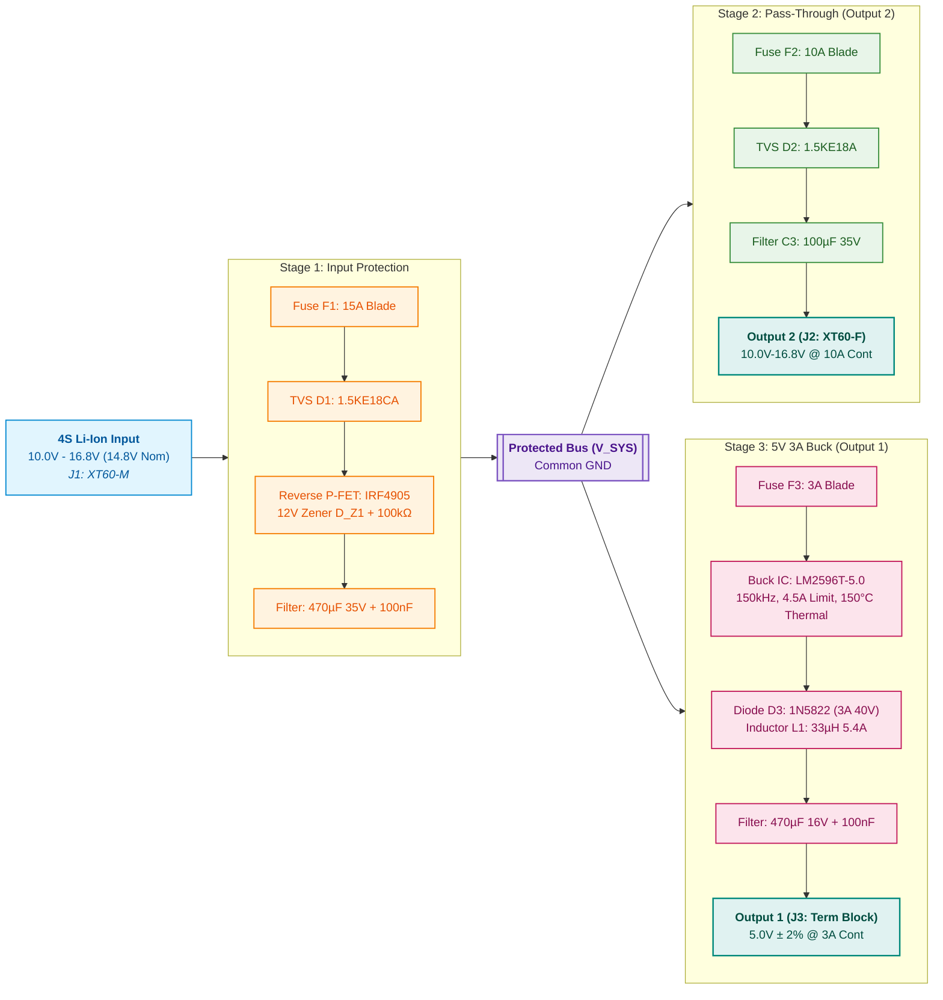

# Assignment 2b: 4S Battery Protection and Power Distribution Board

**Author:** Deepak Rajasekaran  
**Repository:** https://github.com/DeepakRajasekaran/PowerDistributionBoard.git  
**Document Revision:** v1.1  
**Date:** October 2026  
**EDA Suite:** KiCad 9.0  

---

## 1. Project Overview & Requirements

This report details the design and component selection for a 4S lithium-ion battery protection and power distribution board developed in KiCad. The board takes an unregulated battery input and routes power to two separate outputs:

1. **Output 1 (Regulated 5V Rail):** Provides a steady 5.0V at up to 3.0A continuous (15W) using a step-down buck switching regulator. This rail is intended for digital electronics such as flight controllers, single-board computers, and sensors. It features cycle-by-cycle overcurrent protection and automatic thermal shutdown.
2. **Output 2 (Pass-Through Rail):** An unregulated battery pass-through rated for 10.0A continuous (168W peak at full charge), designed to run high-power actuators, DC motors, or ESCs.

The board also includes front-end protection against short circuits, overcurrent, reverse battery connection, and inductive voltage spikes.

---

## 2. Power Architecture & Block Diagram

The board uses an input protection stage followed by two independent output branches. Power enters through an XT60 connector, passes through a primary 15A fuse, a bidirectional TVS diode, and a P-channel MOSFET reverse-polarity circuit. This creates an internal protected bus ($V_{\text{SYS}}$).

From the internal bus, current splits into two separate fused paths:
- The pass-through rail (Output 2) has its own 10A fuse and an 18V TVS clamp.
- The 5V buck converter (Output 1) has a dedicated 3A branch fuse.

Fusing each output independently prevents a short circuit on the motor output from pulling down the 5V logic supply.

---

## 3. Operating Envelope & Assumptions

| Parameter | Value | Notes & Engineering Assumptions |
| :--- | :--- | :--- |
| **Input Voltage Range** | $10.0\text{ V} - 16.8\text{ V}$ | 4S Li-Ion cell range: $2.5\text{ V}$ depleted to $4.2\text{ V}$ fully charged ($14.8\text{ V}$ nominal). |
| **Maximum DC Operating Voltage** | $17.0\text{ V}$ | Upper boundary before input TVS diode D1 ($V_{\text{BR}} = 17.1\text{V} - 18.9\text{V}$) starts conducting. |
| **Transient Clamping Voltage** | $25.2\text{ V}$ peak | Clamping limit during short inductive spikes ($10/1000\ \mu\text{s}$). |
| **Total Continuous Input Current** | $\approx 13.5\text{ A}$ | 10A pass-through + ~1.2A drawn by 5V buck at full load (~80% efficiency) + safety margin. |
| **Ambient Operating Temperature** | $-20^\circ\text{C}$ to $+60^\circ\text{C}$ | Standard industrial / outdoor robotics temperature range. |
| **Trace Temperature Rise** | $\le 15^\circ\text{C}$ | Sized for 2 oz ($70\ \mu\text{m}$) copper on external layers per IPC-2221B. |
| **Output 1 (Regulated)** | $5.0\text{ V} \pm 2\%$, $3.0\text{ A}$ | Low-ripple supply for digital electronics. |
| **Output 1 Ripple** | $< 30\text{ mV}_{\text{p-p}}$ | Filtered using a 470µF electrolytic cap and a 100nF ceramic cap. |
| **Output 2 (Pass-Through)** | $10.0\text{ V} - 16.8\text{ V}$, $10.0\text{ A}$ | High-power branch for DC motors and speed controllers. |
| **Assembly Technology** | 100% Through-Hole (THT) | Selected for easy assembly, field repairability, and sturdy mechanical mounting. |

---

## 4. Circuit Design & Component Selection

### 4.1 Primary Fuse (F1)
I selected a 15A mini automotive blade fuse (`0297015.WXNV`) mounted in a Keystone 3568 through-hole clip. 

With both outputs running at full load, total continuous current is approximately 11.2A to 12.0A. A 15A rating provides roughly 25% to 30% margin over normal operating current, preventing nuisance blowing during startup surges while tripping quickly under short-circuit conditions. Blade fuses also offer very low resistance (around $5\text{ m}\Omega$), keeping voltage drop minimal.

### 4.2 Input Transient Suppressor (D1)
For overvoltage and transient suppression, the input uses a bidirectional TVS diode (`1.5KE18CA`) rated for 1500W peak pulse power.

- **Standoff Voltage ($V_{\text{RWM}}$):** $15.3\text{ V}$
- **Breakdown Voltage ($V_{\text{BR}}$):** $17.1\text{ V} - 18.9\text{ V}$ ($18.0\text{ V}$ typical)
- **Clamping Voltage ($V_{\text{C}}$):** $25.2\text{ V}$ at $59.5\text{ A}$ peak

Because a 4S pack reaches $16.8\text{ V}$ when fully charged, selecting an 18V TVS ensures that the diode stays completely non-conducting during normal charging. If an inductive spike occurs from hot-plugging or motor switching, the diode clamps the spike well below the 35V/50V ratings of the capacitors and the 40V rating of the buck IC. If someone mistakenly connects a continuous 24V supply, D1 conducts heavily to ground and blows fuse F1, protecting the board.

### 4.3 Reverse-Polarity Protection (Q1, D_Z1, R_G1)
Connecting a battery backwards can instantly destroy electronics. While a standard series diode is the simplest solution, at 10A continuous it would drop 0.5V to 0.7V and dissipate:

$$P = I \times V_F = 10\text{ A} \times 0.6\text{ V} = 6.0\text{ W}$$

This would generate excessive heat, require a bulky heatsink, and waste battery life.

Instead, I used an active high-side P-channel MOSFET switch (`IRF4905` in a TO-220 package). The IRF4905 has an on-state resistance ($R_{\text{DS(on)}}$) of only $20\text{ m}\Omega$. At 10A continuous, conduction loss is:

$$P = I^2 \times R_{\text{DS(on)}} = (10\text{ A})^2 \times 0.020\ \Omega = 2.0\text{ W}$$

The TO-220 package easily dissipates 2W in open air without a large heatsink.

**Circuit Operation:**
- **Normal Connection:** When power is applied correctly, the gate is pulled to ground through a 100kΩ resistor ($R_{\text{G1}}$). This gives a negative gate-to-source voltage ($V_{\text{GS}} \approx -V_{\text{IN}}$), turning the MOSFET fully on.
- **Gate Protection:** Because the maximum gate-to-source rating of the IRF4905 is $\pm 20\text{V}$, a 12V Zener diode ($D_{\text{Z1}}$: `1N4742A`) clamps $V_{\text{GS}}$ to -12V. This protects the thin gate oxide when the battery is at its 16.8V maximum.
- **Reverse Connection:** If the battery polarity is reversed, the gate is positive relative to the source ($V_{\text{GS}} \ge 0\text{V}$), keeping the MOSFET off. The internal body diode is reverse-biased, completely blocking reverse current.

### 4.4 Stage 2: Pass-Through Output (F2, D2, C3)
The pass-through output (Output 2) connects through an independent 10A mini blade fuse (`F2`). 

- **Selective Coordination:** Placing F2 on the pass-through channel ensures that if a motor shorts out, only F2 blows. The main 15A input fuse (F1) remains intact, keeping the 5V logic supply running without interruption.
- **Inductive Clamp (D2):** A unidirectional TVS diode (`1.5KE18A`) across Output 2 absorbs inductive flyback voltage spikes caused by motor winding inductance when loads switch off suddenly.
- **Decoupling (C3):** A 100µF 35V low-ESR electrolytic capacitor smooths voltage dips caused by motor startup surges.

### 4.5 Stage 3: Regulated 5V 3A Buck Converter (U1, D3, L1, C_OUT)
To supply 5.0V at up to 3.0A, I chose the Texas Instruments `LM2596T-5.0` switching regulator in a 5-pin TO-220 package.

- **Switching Frequency:** Operates at a fixed 150kHz, allowing the use of a reasonably small 33µH inductor while maintaining conversion efficiency above 80%.
- **Built-in Protection:** The IC includes cycle-by-cycle current limiting set at 4.5A typical, as well as automatic thermal shutdown at 150°C.
- **Branch Fuse (F3):** A 3A fast-acting blade fuse protects the buck stage against catastrophic regulator failure.

**Duty Cycle Calculations:**
The duty cycle $D$ of the buck regulator varies with input voltage:

$$D = \frac{V_{\text{OUT}} + V_D}{V_{\text{IN}} - V_{\text{SAT}} + V_D}$$

Using $V_D = 0.45\text{V}$ for the Schottky diode and $V_{\text{SAT}} \approx 1.1\text{V}$ for the internal switch:
- At nominal battery voltage ($14.8\text{V}$): $D \approx \frac{5.0 + 0.45}{14.8 - 1.1 + 0.45} = \frac{5.45}{14.15} \approx 38.5\%$
- At fully charged battery ($16.8\text{V}$): $D \approx \frac{5.45}{16.15} \approx 33.7\%$
- During a 25V transient clamp: $D \approx \frac{5.45}{24.35} \approx 22.4\%$

Because the LM2596 can operate down to duty cycles below 5%, the closed-loop feedback maintains an exact 5.0V output across the entire input range and during transient voltage spikes.

**Inductor Selection (L1):**
I selected a 33µH, 5.4A through-hole toroidal inductor (`2100HT-330-V-RC`). The peak-to-peak inductor ripple current at 14.8V nominal input is:

$$\Delta I_L = \frac{(V_{\text{IN}} - V_{\text{OUT}}) \cdot D}{f_{\text{sw}} \cdot L_1} = \frac{(14.8 - 5.0)\text{ V} \times 0.385}{150\text{ kHz} \times 33\ \mu\text{H}} \approx 0.76\text{ A}_{\text{p-p}}$$

Peak inductor current at full 3A load is:

$$I_{\text{peak}} = I_{\text{OUT}} + \frac{\Delta I_L}{2} = 3.0\text{ A} + 0.38\text{ A} = 3.38\text{ A}$$

This leaves plenty of margin below the inductor saturation rating of 5.4A, preventing core saturation and overheating.

**Catch Diode (D3):**
The circuit uses a `1N5822G` Schottky diode rated for 3A continuous and 40V reverse breakdown. Its low forward voltage drop (~0.45V at 3A) keeps power dissipation around 1.0W during the switch off-time.

**Output Filtering:**
The output filter combines a 470µF 16V low-ESR electrolytic capacitor (`C_OUT1`, ESR = 45mΩ) and a 100nF ceramic capacitor (`C_OUT2`). The expected output ripple voltage is:

$$V_{\text{ripple(p-p)}} \approx \Delta I_L \times \text{ESR} = 0.76\text{ A} \times 0.045\ \Omega \approx 34\text{ mV}_{\text{p-p}}$$

This is well within acceptable limits for 5V digital circuitry.

---

## 5. Bill of Materials (BOM)

| Item | Ref Des | Qty | Part / Value | Manufacturer | Part Number (MPN) | Package | Description & Rating |
| :---: | :--- | :---: | :--- | :--- | :--- | :--- | :--- |
| 1 | **J1** | 1 | XT60-M | AMASS | `XT60-M` | 2-Pin THT | Battery Input, 60A Peak, 30A Continuous |
| 2 | **F1** | 1 | 15A Blade | Littelfuse / Keystone | `0297015.WXNV` / `3568` | Mini Blade Clip | Main Input Fuse, 15A Fast-Acting, 32VDC |
| 3 | **D1** | 1 | 1.5KE18CA | Littelfuse / Vishay | `1.5KE18CA` | DO-201AD Axial | 1500W Bidirectional TVS, $V_{\text{BR}}=18\text{V}$ |
| 4 | **Q1** | 1 | IRF4905 | Infineon | `IRF4905PBF` | TO-220-3 | P-Channel MOSFET, -55V, -74A, $R_{\text{DS(on)}}=20\text{m}\Omega$ |
| 5 | **D_Z1** | 1 | 1N4742A | onsemi / Vishay | `1N4742A` | DO-41 Axial | 12V Zener Diode, 1W, Gate Oxide Clamp |
| 6 | **R_G1** | 1 | 100kΩ | Yageo | `MFR-25FRF52-100K` | DO-207 Axial | Metal Film Resistor, 0.25W, 1% |
| 7 | **C1** | 1 | 470µF 35V | Panasonic | `EEU-FR1V471` | Radial D10 P5.0 | Input Filter, Low-ESR ($28\text{m}\Omega$), 1.79A Ripple |
| 8 | **C2, C_OUT2**| 2 | 100nF 50V | KEMET / WIMA | `MKS2B041001C00KSSD` | Radial 5mm | High-Frequency Bypass, 50V Film/Ceramic |
| 9 | **F2** | 1 | 10A Blade | Littelfuse / Keystone | `0297010.WXNV` / `3568` | Mini Blade Clip | Pass-Through Fuse, 10A Fast-Acting, 32VDC |
| 10 | **D2** | 1 | 1.5KE18A | Littelfuse / Vishay | `1.5KE18A` | DO-201AD Axial | 1500W Unidirectional TVS, $V_{\text{BR}}=18\text{V}$ |
| 11 | **C3** | 1 | 100µF 35V | Panasonic | `EEU-FR1V101` | Radial D8 P3.5 | Pass-Through Buffer, Low-ESR ($56\text{m}\Omega$) |
| 12 | **J2** | 1 | XT60-F | AMASS | `XT60-F` | 2-Pin THT | Output 2 Pass-Through, 10A Cont, 30A Max |
| 13 | **F3** | 1 | 3A Blade | Littelfuse / Keystone | `0297003.WXNV` / `3568` | Mini Blade Clip | Buck Branch Fuse, 3A Fast-Acting, 32VDC |
| 14 | **U1** | 1 | LM2596T-5.0 | Texas Instruments | `LM2596T-5.0/NOPB` | TO-220-5 | 5V 3A Step-Down Buck Regulator, 150kHz |
| 15 | **D3** | 1 | 1N5822 | onsemi | `1N5822G` | DO-201AD Axial | Schottky Catch Diode, 3A, 40V, $V_F=0.45\text{V}$ |
| 16 | **L1** | 1 | 33µH 5A | Bourns | `2100HT-330-V-RC` | Toroid Vertical | Power Inductor, 33µH, 5.4A IDC, $35\text{m}\Omega$ DCR |
| 17 | **C_OUT1**| 1 | 470µF 16V | Panasonic | `EEU-FR1C471` | Radial D8 P3.5 | Output Filter, Low-ESR ($45\text{m}\Omega$), 1.29A Ripple |
| 18 | **J3** | 1 | MKDS 1,5/2-5,08 | Phoenix Contact | `1729018` | 5.08mm Screw | Output 1 Terminal Block, 17.5A, Wire 26-14 AWG |
| 19 | **MH1-4**| 4 | Mounting Hole | Standard Hardware | `M3_3.2MM_PAD` | M3 Clearance | 3.2mm Drill, Plated Ground Mounting Holes |

---

## 6. References & Component Sources

1. **Design Guidelines:**
   - IPC-2221B: *Generic Standard on Printed Board Design* (trace width and thermal rise rules).
   - IPC-7351B: *Generic Requirements for Surface Mount and Through-Hole Design*.
2. **Datasheets:**
   - Texas Instruments: *LM2596 SIMPLE SWITCHER Power Converter 150-kHz 3-A Step-Down Voltage Regulator* (SNVS124D).
   - Infineon Technologies: *IRF4905PBF -55V Single P-Channel HEXFET Power MOSFET* (PD-94770).
   - Littelfuse Inc.: *MINI Blade Fuse 32V Series*.
   - Phoenix Contact: *MKDS 1,5/ 2-5,08 Printed-Circuit Board Terminal Block* (Product 1729018).
3. **CAD Libraries:**
   - KiCad standard library footprints and 3D STEP models (`Connector_AMASS`, `Fuse`, `Diode_THT`, `Package_TO_SOT_THT`, `TerminalBlock_Phoenix`, `Inductor_THT`).

---

## 7. PCB Layout & Manufacturing Considerations

1. **Layer Stack & Copper Weight:**
   The board is designed as a standard 2-layer FR4 PCB with 1.6mm thickness and 2 oz ($70\ \mu\text{m}$) outer copper. Using 2 oz copper significantly reduces trace resistance and heating on the high-current paths.
2. **High-Current Routing:**
   - The primary input path (from J1 through F1, Q1, and to the bus) and the pass-through output (F2 to J2) carry up to 10A to 15A.
   - Per IPC-2221B guidelines, these traces are sized between 3.5mm and 5.0mm in width, keeping conductor temperature rise well under 15°C.
   - Both the top and bottom layers feature solid copper ground pours tied together with ground stitching, providing a low-impedance return path for DC current and buck switching noise.
3. **Thermal Management:**
   - The TO-220 devices (MOSFET Q1 and buck IC U1) are positioned with ample clearance so their metal mounting tabs can dissipate heat into the air without crowding adjacent tall components.
   - Through-hole pads on large copper pours use 4-spoke thermal relief connections to allow easy hand soldering with standard soldering irons.
4. **Mechanical Layout & Usability:**
   - XT60 connectors are placed along board edges to allow easy battery mating.
   - The 5.08mm screw terminal block (J3) is oriented with its wire entry holes facing outward toward the PCB edge, making wire insertion and screw tightening straightforward once the board is mounted in an enclosure.
   - Four M3 mounting holes are placed at the board corners, plated to ground.

---

## 8. Verification & Pre-Power Testing Procedure

Before applying battery power to the assembled board, perform the following verification steps:

1. **Visual & Continuity Inspection:**
   - Check all solder joints for bridges, especially around the 5-pin TO-220 regulator and connector pins.
   - Measure resistance between $V_{\text{SYS}}$ and GND with a multimeter. Ensure it reads $> 100\text{ k}\Omega$ (no short circuits).
   - Measure resistance between the 5V output and GND (should read $> 1\text{ k}\Omega$).
2. **Reverse Polarity Test:**
   - Connect a bench power supply set to 14.8V with the current limit set to 100mA.
   - Connect the supply in reverse polarity (positive to pin 2, negative to pin 1 of J1).
   - Verify that the power supply shows 0mA current draw and that $V_{\text{SYS}}$ measures 0.0V.
3. **Forward Voltage & Regulation Test:**
   - Connect the bench supply in correct polarity at 14.8V.
   - Measure Output 2 (J2): should match the input voltage minus the small $20\text{ m}\Omega$ drop across Q1.
   - Measure Output 1 (J3): should read $5.00\text{ V} \pm 0.1\text{ V}$.
   - Sweep the input voltage from 10.0V to 16.8V; confirm that Output 1 stays regulated at 5.0V with no oscillation.
