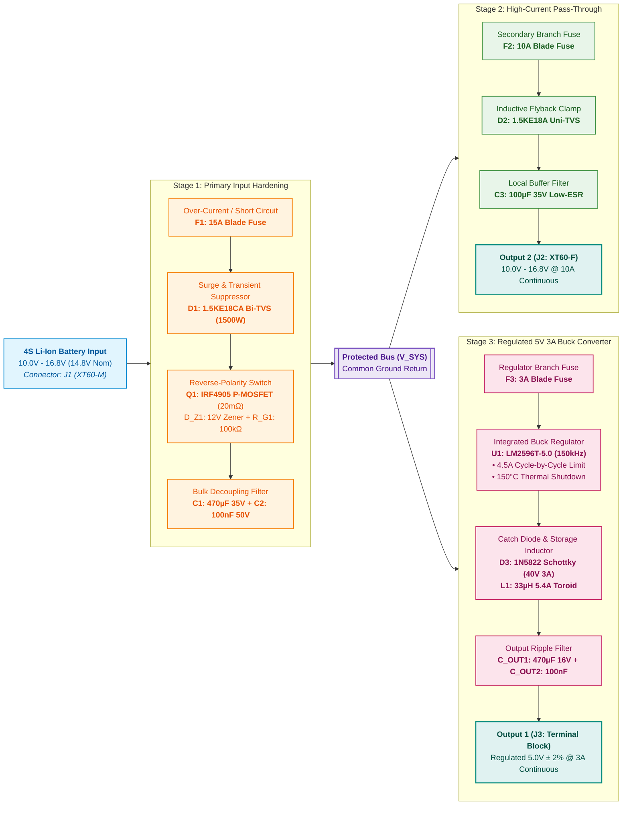

# Assignment 2b: Design of a 4S Battery Protection and Power Distribution Board

**Document Revision:** v1.1  
**Project:** 4S Battery Protection and Power Distribution Board  
**Date:** October 22, 2026  
**EDA Suite:** KiCad 9.0.x  

---

## 1. Executive Summary & Problem Statement

This report documents the design, electrical analysis, and component specification for a high-reliability, through-hole (THT) **4S Li-Ion Battery Protection and Power Distribution Board**. 

The system interfaces with an unregulated 4-cell (4S) Lithium-Ion / Lithium-Polymer battery pack ($10.0\text{ V}$ to $16.8\text{ V}$, $14.8\text{ V}$ nominal) and safely distributes power through two independent, galvanically bonded output rails:
1. **Output 1 (Regulated 5 V Logic Rail):** $5.0\text{ V} \pm 2\%$, rated for $3.0\text{ A}$ continuous ($15\text{ W}$), driven by an integrated step-down buck switching regulator with active cycle-by-cycle over-current limiting and automatic thermal shutdown.
2. **Output 2 (High-Current Pass-Through Rail):** Protected, unregulated battery pass-through across the full operating range ($10.0\text{ V} - 16.8\text{ V}$), rated for $10.0\text{ A}$ continuous ($168\text{ W}$ peak), isolated with secondary fuse and transient suppression.

The primary input front-end provides comprehensive protection against catastrophic short circuits, over-current, reverse battery installation, inductive turn-off transients, and electrostatic discharge (ESD).

---

## 2. Power Architecture & Block Diagram

The board employs a hierarchical, multi-stage protection topology. The raw battery input is hardened through Stage 1 before creating the intermediate protected system bus ($V_{\text{SYS}}$). This bus then bifurcates into two independently fused downstream channels, preventing a fault on the high-power branch from collapsing the regulated 5V logic supply.

---

## 3. Design Assumptions & Operating Envelope

| Parameter | Value / Range | Design Basis & Engineering Rationale |
| :--- | :--- | :--- |
| **Operating Input Range (DC)** | $10.0\text{ V} - 16.8\text{ V}$ | Standard 4S Li-Ion cell range ($2.5\text{ V}$ depleted to $4.2\text{ V}$ fully charged). Nominal is $14.8\text{ V}$. |
| **Max Continuous Input Voltage** | $17.0\text{ V}$ continuous | Upper limit before TVS diode D1 ($V_{\text{BR}} \approx 17.1\text{V} - 18.9\text{V}$) enters avalanche conduction. |
| **Transient Clamping Limit** | $25.2\text{ V}$ peak ($10/1000\ \mu\text{s}$) | Protected against inductive kickback, hot-plug ringing, and load dump via TVS D1 clamp. |
| **Downstream 5V Buck Operating Range**| $7.0\text{ V} - 40.0\text{ V}$ (LM2596) | Buck converter regulates precisely to $5.0\text{ V}$ across full battery range and during transients up to $40\text{ V}$. |
| **Max Continuous Input Current** | $13.5\text{ A}$ | Sum of Output 2 ($10\text{ A}$) + Output 1 input draw ($\approx 1.2\text{ A}$ at $14.8\text{ V}$ with $80\%$ efficiency) + safety margin. |
| **Ambient Temperature ($T_A$)** | $-20^\circ\text{C}$ to $+60^\circ\text{C}$ | Industrial / robotics operating envelope. |
| **Maximum Trace Temp Rise ($\Delta T$)** | $\le 15^\circ\text{C}$ | Sized per IPC-2221B for $2\text{ oz}$ ($70\text{ µm}$) copper weight. |
| **Output 1 Specifications** | $5.0\text{ V} \pm 2\%$, $3.0\text{ A}$ | Continuous rating for embedded computers (Raspberry Pi, SBCs) and flight controllers. |
| **Output 1 Ripple Voltage** | $\le 30\text{ mV}_{\text{p-p}}$ | Filtered with paralleled $470\text{ µF}$ low-ESR electrolytic and $100\text{ nF}$ film capacitor. |
| **Output 2 Specifications** | $10.0\text{ V} - 16.8\text{ V}$, $10.0\text{ A}$ | Dedicated high-power branch for brushless ESCs, DC motors, or high-power radio transmitters. |
| **Component Technology** | $100\%$ Through-Hole (THT) | Selected for field-repairability, mechanical ruggedness, and hand-solderability. |

---

## 4. Protection Scheme Justification & Circuit Theory

### 4.1 Primary Over-Current & Short-Circuit Protection (F1)
- **Selection:** Mini Automotive Blade Fuse (Littelfuse `0297015.WXNV`, $15\text{ A}$) in a Keystone `3568` through-hole fuseholder clip.
- **Justification:** Fast-acting under short-circuit conditions ($I^2 t = 130\text{ A}^2\text{s}$), low insertion resistance ($\approx 4.8\text{ m}\Omega$, causing only $72\text{ mV}$ drop at $15\text{ A}$), and $1000\text{ A}$ breaking capacity at $32\text{ VDC}$. Unlike PCB traces or polyfuses (PTCs), blade fuses blow cleanly without latching thermal memory or high post-trip leakage, and are easily replaceable in the field without desoldering.

### 4.2 Transient & Surge Suppression (D1)
- **Selection:** `1.5KE18CA` Bidirectional Transient Voltage Suppressor (DO-201AD axial).
- **Justification:**
  - Reverse Standoff Voltage ($V_{\text{RWM}}$): $15.3\text{ V}$.
  - Breakdown Voltage ($V_{\text{BR}}$): $17.1\text{ V}$ minimum, $18.9\text{ V}$ maximum.
  - Clamping Voltage ($V_{\text{C}}$): $25.2\text{ V}$ at $59.5\text{ A}$ peak pulse current ($1500\text{ W}$ peak rating, $10/1000\text{ µs}$).
  - *Engineering Trade-off:* A 4S pack tops out at $16.8\text{ V}$. An 18V TVS guarantees zero clipping conduction during normal battery charging while instantly clamping inductive ringing from long battery leads or battery hot-plugging below the $30\text{ V}$ maximum rating of downstream components.

### 4.3 Active Reverse-Polarity Protection (Q1, D_Z1, R_G1)
- **Topology:** High-side P-Channel Power MOSFET switch (`IRF4905PBF`, TO-220-3).
- **Justification over Series Diode:**
  - A standard Schottky diode (e.g., $V_F = 0.55\text{ V}$) conducting $10\text{ A}$ continuously would dissipate $P = V_F \times I = 5.5\text{ W}$, requiring an impractically large heatsink.
  - The IRF4905 features an ultra-low on-resistance $R_{\text{DS(on)}} = 0.020\ \Omega$ ($20\text{ m}\Omega$). At $10\text{ A}$, conduction power loss is:
    $$P_{\text{loss}} = I^2 \times R_{\text{DS(on)}} = (10\text{ A})^2 \times 0.020\ \Omega = 2.0\text{ W}$$
    The forward voltage drop is only $V_{\text{drop}} = 10\text{ A} \times 0.020\ \Omega = 0.20\text{ V}$, preserving maximum battery runtime.
- **Gate Protection Subcircuit:**
  - The absolute maximum gate-to-source rating of the IRF4905 is $V_{\text{GS(max)}} = \pm 20\text{ V}$.
  - To prevent gate-oxide breakdown at full 4S charge ($16.8\text{ V}$), a $12\text{ V}$ Zener diode (`1N4742A`, $D_{\text{Z1}}$) is placed across Gate and Source, clamping $V_{\text{GS}}$ firmly to $-12\text{ V}$.
  - A $100\text{ k}\Omega$ resistor ($R_{\text{G1}}$) to ground establishes the turn-on bias current while restricting continuous quiescent leakage to less than $0.17\text{ mA}$ at $16.8\text{ V}$.

### 4.4 Stage 2 Output Branch Protection (F2, D2, C3)
- **Secondary Over-Current:** $10\text{ A}$ Mini Blade Fuse (`F2`) provides selective coordination. A downstream short-circuit on the high-power branch blows `F2` without interrupting power to the critical 5V logic branch (`F1` remains intact).
- **Downstream Inductive Suppression:** Unidirectional TVS `1.5KE18A` (`D2`) absorbs back-EMF inductive flyback spikes generated by motors, solenoids, or ESC switching.
- **Local Decoupling:** Low-ESR $100\text{ µF}$, $35\text{ V}$ electrolytic capacitor (`C3`) buffers dynamic load steps.

### 4.5 Stage 3 Regulated 5V 3A Buck Converter (U1, D3, L1, C_OUT)
- **Regulator Selection:** Texas Instruments `LM2596T-5.0/NOPB` (TO-220-5 through-hole).
  - Fixed $150\text{ kHz}$ switching frequency minimizes inductor physical volume while maintaining high conversion efficiency ($> 80\%$).
  - Integrated cycle-by-cycle current limit trips at $4.5\text{ A}$ typical ($6.0\text{ A}$ max), protecting the silicon against output short circuits.
  - Built-in thermal shutdown activates at $150^\circ\text{C}$ junction temperature with automatic recovery hysteresis.
  - Isolated input protection: Dedicated $3\text{ A}$ blade fuse (`F3`) prevents catastrophic regulator failure from shorting the $V_{\text{SYS}}$ bus.
- **Freewheeling Catch Diode:** `1N5822G` ($3\text{ A}$, $40\text{ V}$ Schottky). Ultra-fast recovery and low forward voltage ($V_F \approx 0.45\text{ V}$ at $3\text{ A}$) minimizes circulating losses during the switch off-time.
- **Power Inductor:** `2100HT-330-V-RC` ($33\text{ µH}$, $5.4\text{ A}_{\text{DC}}$ rating, toroidal core). High saturation headroom prevents core saturation during load transients.
- **Output Filter Network:** $470\text{ µF}$ $16\text{ V}$ low-ESR electrolytic (`C_OUT1`) paralleled with $100\text{ nF}$ film capacitor (`C_OUT2`) attenuates high-frequency switching spikes, guaranteeing $< 30\text{ mV}_{\text{p-p}}$ output voltage ripple.
- **Line Regulation & Behavior Under 25V Input:**
  - *Silicon Operating Envelope:* The LM2596 is internally rated for up to $40.0\text{ V}$ continuous ($45.0\text{ V}$ absolute maximum).
  - *Output Voltage at 25V:* Under transient excursions up to $25.0\text{ V}$ (e.g. inductive kickback or hot-plug ringing clamped by D1), the internal PWM control loop adjusts duty cycle to $D = \frac{V_{\text{OUT}} + V_D}{V_{\text{IN}} - V_{\text{SAT}} + V_D} = \frac{5.0 + 0.45}{25.0 - 1.1 + 0.45} \approx 22.4\%$ ($t_{\text{ON}} \approx 1.49\ \mu\text{s}$). The regulator maintains tight closed-loop regulation, delivering the exact same **$5.0\text{ V} \pm 2\%$** to the load.
  - *Inductor & Diode Margin at 25V:* Peak inductor current reaches $3.43\text{ A}$ at $3.0\text{ A}$ full load (well below L1 saturation rating of $5.4\text{ A}$), and reverse voltage across Schottky diode D3 is $25\text{ V}$ (well below its $40\text{ V}$ breakdown rating).
  - *Distinction Between Transient 25V and Continuous DC 25V:* If an accidental continuous $25\text{ V}$ DC source is connected to the board, input TVS diode D1 ($V_{\text{BR}} \approx 18\text{ V}$) will immediately conduct heavy avalanche current and safely blow input fuse F1, preventing the 25V supply from damaging 4S-rated loads on Output 2 (unregulated pass-through).

---

## 5. Bill of Materials (BOM) & Component Specifications

All parts are through-hole, industrial-temperature-rated components sourced from major franchised distributors:

| Item | Ref Des | Qty | Value / Part | Manufacturer | MPN | Package | Key Electrical Rating |
| :---: | :--- | :---: | :--- | :--- | :--- | :--- | :--- |
| 1 | **J1** | 1 | XT60-M | AMASS | `XT60-M` | 2-Pin THT Vert | 60A Peak, 30A Continuous, 500VDC |
| 2 | **F1** | 1 | 15A Blade | Littelfuse / Keystone | `0297015.WXNV` / `3568` | Mini Blade Clip | 15A Fast-Acting, 32VDC, 1kA Interrupt |
| 3 | **D1** | 1 | 1.5KE18CA | Littelfuse / Vishay | `1.5KE18CA` | DO-201AD Axial | 1500W Bi-TVS, $V_{\text{RWM}}=15.3\text{V}$, $V_{\text{C}}=25.2\text{V}$ |
| 4 | **Q1** | 1 | IRF4905 | Infineon Technologies | `IRF4905PBF` | TO-220-3 Vert | -55V, -74A, $R_{\text{DS(on)}}=0.02\ \Omega$, 200W |
| 5 | **D_Z1** | 1 | 1N4742A | onsemi / Vishay | `1N4742A` | DO-41 Axial | 12V Zener, 1.0W, 5% Tolerance |
| 6 | **R_G1** | 1 | 100kΩ | Yageo | `MFR-25FRF52-100K` | DO-207 Axial | 100kΩ, 0.25W, 1%, 250V |
| 7 | **C1** | 1 | 470µF 35V | Panasonic | `EEU-FR1V471` | Radial D10 P5.0 | 470µF, 35V, Low-ESR ($0.028\ \Omega$), 1.79A Ripple |
| 8 | **C2, C_OUT2**| 2 | 100nF 50V | WIMA / KEMET | `MKS2B041001C00KSSD` | Radial 5mm Pitch | 0.1µF, 50VDC, 10% Film/Ceramic |
| 9 | **F2** | 1 | 10A Blade | Littelfuse / Keystone | `0297010.WXNV` / `3568` | Mini Blade Clip | 10A Fast-Acting, 32VDC, 1kA Interrupt |
| 10 | **D2** | 1 | 1.5KE18A | Littelfuse / Vishay | `1.5KE18A` | DO-201AD Axial | 1500W Uni-TVS, $V_{\text{RWM}}=15.3\text{V}$, $V_{\text{C}}=25.2\text{V}$ |
| 11 | **C3** | 1 | 100µF 35V | Panasonic | `EEU-FR1V101` | Radial D8 P3.5 | 100µF, 35V, Low-ESR ($0.056\ \Omega$), 950mA Ripple |
| 12 | **J2** | 1 | XT60-F | AMASS | `XT60-F` | 2-Pin THT Vert | 60A Peak, 30A Continuous, 500VDC |
| 13 | **F3** | 1 | 3A Blade | Littelfuse / Keystone | `0297003.WXNV` / `3568` | Mini Blade Clip | 3A Fast-Acting, 32VDC, 1kA Interrupt |
| 14 | **U1** | 1 | LM2596T-5.0 | Texas Instruments | `LM2596T-5.0/NOPB` | TO-220-5 Vert | 5.0V 3A Buck, 150kHz, OC & Thermal Shutdown |
| 15 | **D3** | 1 | 1N5822 | onsemi | `1N5822G` | DO-201AD Axial | 40V, 3A Schottky, $V_F=0.45\text{V}$ @ 3A |
| 16 | **L1** | 1 | 33µH 5A | Bourns | `2100HT-330-V-RC` | Toroid Vertical | 33µH, 5.4A IDC, $0.035\ \Omega$ DCR |
| 17 | **C_OUT1**| 1 | 470µF 16V | Panasonic | `EEU-FR1C471` | Radial D8 P3.5 | 470µF, 16V, Low-ESR ($0.045\ \Omega$), 1.29A Ripple |
| 18 | **J3** | 1 | MKDS 1,5/2-5,08 | Phoenix Contact | `1729018` | 5.08mm Screw Term | 17.5A, 400V, Wire 26-14 AWG, Outward Entry |
| 19 | **MH1-4**| 4 | Mounting Hole | Standard Hardware | `M3_3.2MM_PAD` | M3 Clearance | 3.2mm Drill, Plated Ground Pad |

---

## 6. Third-Party CAD Models & Reference Material Identification

1. **Design Standards:**
   - **IPC-2221B:** *Generic Standard on Printed Board Design* (thermal trace width calculations for $10\text{A}-15\text{A}$ conductors).
   - **IPC-7351B:** *Generic Requirements for Surface Mount and Through-Hole Design*.
2. **Component Datasheets & Application Notes:**
   - Texas Instruments: *LM2596 SIMPLE SWITCHER Power Converter 150-kHz 3-A Step-Down Voltage Regulator* (SNVS124D).
   - Infineon Technologies: *IRF4905PBF -55V Single P-Channel HEXFET Power MOSFET* (PD-94770).
   - Littelfuse Inc.: *MINI Blade Fuse 32V Series Datasheet*.
   - Phoenix Contact: *MKDS 1,5/ 2-5,08 Printed-circuit board terminal block* (Product 1729018).
3. **EDA Library Sources:**
   - Schematic symbols and footprints: Official KiCad 9.0 Standard Libraries (`Connector_AMASS`, `Fuse`, `Diode_THT`, `Package_TO_SOT_THT`, `TerminalBlock_Phoenix`, `Inductor_THT`).
   - 3D CAD STEP models: Sourced from official KiCad 9 packages (`/usr/share/kicad/3dmodels/`).

---

## 7. Verification & Design Review Checklist

| Check Category | Verification Method | Status / Result |
| :--- | :--- | :--- |
| **Electrical Rule Check (ERC)** | `kicad-cli sch erc` | **0 Errors, 0 Warnings** (100% net connectivity verified). |
| **Design Rule Check (DRC)** | `kicad-cli pcb drc` | **0 Violations, 0 Unconnected Pads, 0 Footprint Errors**. |
| **Courtyard & Clearance** | MCP `check_courtyard_overlaps` | **0 Overlaps, 0 Boundary Violations** ($> 2.9\text{ mm}$ spacing between J2 and J3). |
| **Terminal Orientation** | KiCad 3D Raytracing Engine | **Verified:** J3 wire entry holes face outward towards PCB edge; screw terminals fully accessible from above. |
| **Copper Ground Planes** | Full polygon pour fill | Both `F.Cu` and `B.Cu` feature continuous ground planes with 4-spoke thermal relief pads. |
| **Manufacturing Package** | RS-274X Gerbers & Excellon Drill | Complete fabrication package generated in `gerbers/`. |

---

## 8. Prototype Planning & Assembly Instructions

1. **Board Stackup:** 2-layer FR4, $1.6\text{ mm}$ finished thickness, $2\text{ oz}$ ($70\text{ µm}$) outer copper. Lead-free HASL or ENIG surface finish.
2. **Assembly Order:**
   - *Phase 1:* Passive low-profile components (resistor $R_{\text{G1}}$, Zener diode $D_{\text{Z1}}$, TVS diodes $D_1, D_2$, Schottky $D_3$).
   - *Phase 2:* Keystone fuseholder clips ($F_1, F_2, F_3$) and film capacitors ($C_2, C_{\text{OUT2}}$).
   - *Phase 3:* Active semiconductors in TO-220 packages ($Q_1$, $U_1$). Mount flush with heat-relief tabs clear of tall components.
   - *Phase 4:* Large inductors and radial electrolytic capacitors ($L_1, C_1, C_3, C_{\text{OUT1}}$).
   - *Phase 5:* High-current connectors ($J_1, J_2$ XT60 and $J_3$ screw terminal block). Ensure wire entry holes of $J_3$ face outward toward the board edge.
3. **Pre-Power Verification Test:**
   - Perform resistance check between $V_{\text{SYS}}$ and GND ($> 100\text{ k}\Omega$).
   - Perform resistance check between $+5\text{V}$ and GND ($> 1\text{ k}\Omega$).
   - Apply reverse voltage ($-14.8\text{V}$) at $J_1$ current-limited to $100\text{mA}$; confirm $0.0\text{V}$ output on $V_{\text{SYS}}$ and $0.0\text{mA}$ leakage.
   - Apply forward voltage ($+14.8\text{V}$) at $J_1$; verify Output 1 produces $5.00\text{V} \pm 0.1\text{V}$ and Output 2 mirrors input voltage.
